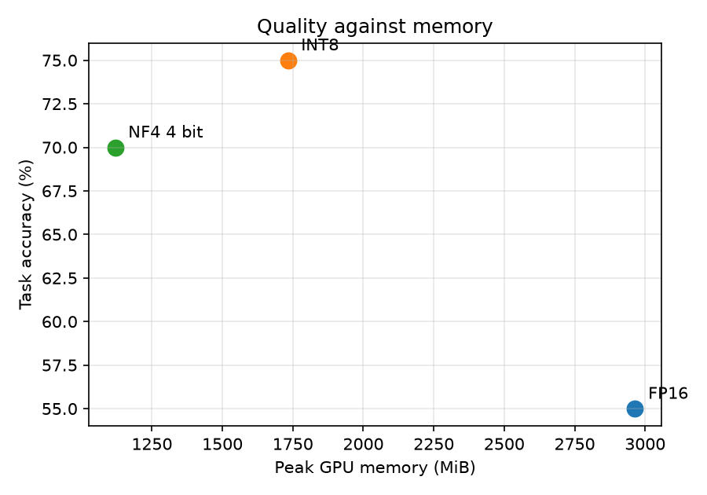

# quantbench

How much numerical precision does a small instruction model actually need, and what does
quantization cost in task quality once you measure it rather than assume it?

This repository runs one open model at three precisions over a fixed task set and records
quality alongside latency, throughput and peak GPU memory. Every run is logged to MLflow with
its configuration, so a comparison is reproducible rather than anecdotal.

## What it measures

| Axis | Metrics |
|---|---|
| Quality | overall accuracy, and separately on reasoning and coding tasks |
| Latency | mean wall clock per task, mean time to first token |
| Throughput | generated tokens per second |
| Memory | peak allocated during generation, and the weights alone after load |

## Precisions compared

- **FP16** baseline, no quantization
- **INT8** through bitsandbytes `load_in_8bit`
- **NF4** through bitsandbytes `load_in_4bit`, nf4 quant type, double quantization,
  FP16 compute dtype

## Method

Twenty fixed tasks, ten short reasoning questions with a single checkable answer and ten
coding tasks scored by executing the generated function against assertions. Greedy decoding
throughout, so differences between runs come from the weights and not from sampling. One
untimed warmup generation before measurement, and `torch.cuda.synchronize()` around every
timed section, because without it you are timing the queue rather than the kernel.

Peak memory is read from `torch.cuda.max_memory_allocated()`, reset after load, so the
reported figure is generation peak rather than load peak.

## Running it

```bash
pip install -r requirements.txt
./run_all.sh                      # all three precisions, then the report
```

or one configuration at a time:

```bash
python -m src.run_eval --precision fp16
python -m src.run_eval --precision int8
python -m src.run_eval --precision nf4
python -m src.report
mlflow ui                         # compare runs side by side
```

Default model is `Qwen/Qwen2.5-1.5B-Instruct`. Override with `--model`.

A CUDA GPU is required; the numbers are meaningless on CPU.

## Results

Qwen2.5-1.5B-Instruct, single NVIDIA RTX 4060 Laptop GPU, 8 GB, greedy decoding,
`max_new_tokens=256`, 20 tasks.

| Precision | Overall | Reasoning | Coding | Tok/s | Mean latency | Peak memory |
|---|---|---|---|---|---|---|
| FP16 | 55% | 30% | 80% | 19.3 | 7.16 s | 2964 MiB |
| INT8 | 75% | 50% | 100% | 4.4 | 28.61 s | 1733 MiB |
| NF4 4 bit | 70% | 40% | 100% | 14.6 | 6.23 s | 1119 MiB |



## Findings

**1. NF4 is the only quantization here that pays for itself.**
It cuts peak memory to 38% of FP16, 1119 MiB against 2964 MiB, while staying within about 25%
of FP16 throughput. On this hardware FP16 and NF4 are the two points on the frontier.

**2. INT8 uses less memory and is roughly four times slower.**
4.4 tokens per second against 19.3 for FP16, and mean latency of 28.6 seconds per task against
7.2. This is not a measurement artefact; it reproduced across two independent passes. The
common assumption that lower precision means faster is wrong here. `bitsandbytes` LLM.int8()
performs mixed-precision decomposition at runtime, separating outlier features into FP16 and
recombining, and on a consumer GPU that overhead dominates whatever the smaller weights save.

**3. The quality numbers cannot support a conclusion at this sample size, and say so loudly.**
Wilson 95% intervals on these counts:

| Precision | Overall | Reasoning |
|---|---|---|
| FP16 | 55% [34, 74] | 30% [11, 60] |
| INT8 | 75% [53, 89] | 50% [24, 76] |
| NF4 | 70% [48, 85] | 40% [17, 69] |

Every interval overlaps every other interval. The apparent spread is four tasks overall and
three on reasoning. More to the point, the ranking is impossible: quantization removes
information, so a quantized model scoring above its own FP16 baseline on every measure is not
a finding, it is the noise floor becoming visible. Twenty tasks is enough to catch a large
regression and nowhere near enough to resolve a small one. Resolving quality differences here
needs roughly 100 tasks per category, which would bring the intervals to about plus or minus
10 points.

## What the first run got wrong

The first pass reported **10% reasoning accuracy at all three precisions**, identically.

A model cannot produce the same score under three different weight configurations, so the
fault had to be in the measurement rather than the model. It was: the scorer normalised only
the **first line** of the completion, while an instruction-tuned model asked for a bare value
usually writes a sentence of reasoning first and puts the answer at the end. The grader was
reading the wrong line every time.

The fix extracts every plausible answer token from the whole completion, times, numbers, yes
and no, and accepts a match anywhere, with the tasks written so only one value in a response
can be the answer. Reasoning accuracy moved to 30, 50 and 40 percent.

Worth stating plainly: an identical score across configurations that should differ is a
signature of a broken harness, not a property of the system under test. It was the most useful
thing this project produced.

## A second thing worth recording

The same three configurations ran 20 to 33% faster on the second pass than the first, with
generation code and decoding parameters unchanged:

| Precision | Pass 1 tok/s | Pass 2 tok/s |
|---|---|---|
| FP16 | 15.9 | 19.3 |
| INT8 | 3.5 | 4.4 |
| NF4 | 11.0 | 14.6 |

The shift is systematic rather than random, so it is almost certainly machine state, a warm
filesystem cache and different GPU clock and power behaviour on a laptop, rather than anything
about the models. The practical consequence: **absolute throughput here is only meaningful
within a single session.** Comparisons across sessions are not valid, and the ratios between
precisions, which held across both passes, are the trustworthy part.

## Caveats

- Twenty tasks resolves large regressions only. See finding 3.
- Coding tasks are scored by execution, so a correct solution in an unexpected format still
  passes, but a correct explanation with no code block fails.
- `score_python` executes model generated code. Run this in a container or a throwaway VM.
- bitsandbytes quantizes linear layers and leaves embeddings, normalisation and the LM head in
  higher precision, so the memory saving is below the nominal ratio.
- Latency here is single request and unbatched. Throughput under concurrency is a different
  measurement and is not covered.
- One model and one size. Nothing here should be generalised to larger models, where the
  arithmetic of memory bandwidth against compute is different.

## Next

- Expand to roughly 100 tasks per category so quality differences become resolvable.
- Add a second model size to see whether the INT8 throughput penalty narrows.
- Measure batched throughput, which is the number that matters for serving.
